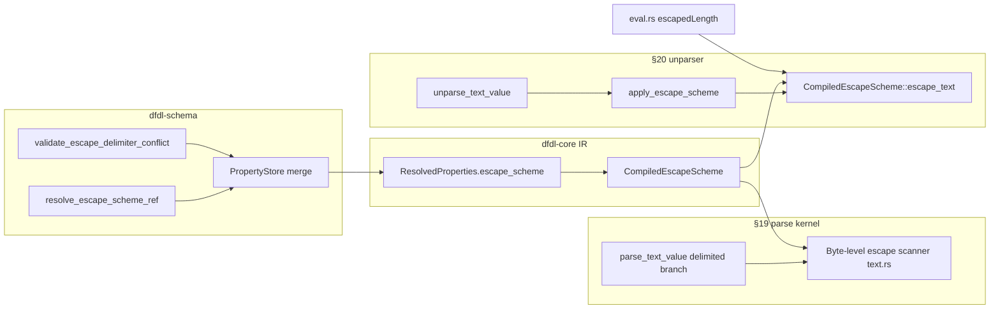

# DFDL 1.0 §19 (Escapes) & §20 (Unparse) — GFD-R-P.240 Gap Audit

**Scope:** `/workspace` — `dfdl-core` kernel (`kernel/unparser.rs`, `kernel/parser/text.rs`, `kernel/parser/delimiters.rs`, `kernel/parser/element.rs`), `CompiledEscapeScheme` in `schema/ir.rs`, compiler escape wiring in `dfdl-schema` (`compiler/annotations.rs`, `compiler/lower.rs`), property lowering in `expr/properties.rs`. **Excluded:** `dfdl-vm`.

**Normative baseline:** OGF GFD-R-P.240 (DFDL 1.0). §19 covers delimiter scanning and escape processing during **parse**; §20 covers the inverse **unparse** processing model (value emission, escaping, framing). §13.2.1 defines `dfdl:escapeScheme` properties compiled into `CompiledEscapeScheme`.

**Evidence:** Source inspection and in-crate unit tests only (not TDML pass/fail matrices).

---

## Executive summary — top 10 gaps (§19 / §20)

| Rank | Gap | Spec | Impact |
|------|-----|------|--------|
| 1 | **`emptyValueDelimiterPolicy` parse-only** | §12.3.4, §20 | Unparser always emits initiator/terminator when defined; parser skips per `emptyValueDelimiterPolicy`. Empty delimited values round-trip wrong. |
| 2 | **Escape scanning disabled for sub-byte encodings** | §13.2.1, §19 | `parse_text_value` delimited path for bit-packed encodings never enters escape scanner; unparse returns before `apply_escape_scheme` in `unparse_sub_byte_text` early exit. |
| 3 | **Escape on unparse for non-delimited lengths** | §19 vs §20 | Parser applies escapes only when `dynamic_len` is `None` (delimited scan). Unparser applies `escape_scheme` in `unparse_text_value` for **all** length kinds once past sub-byte check. |
| 4 | **In-scope delimiter set mismatch (parse vs unparse vs expressions)** | §13.2.1, §19 | Parse escape scan uses terminator, separator, `in_scope_delimiters` (`text.rs:297-312`). Unparse uses `active_delimiters` (sequence separator/terminator tokens + element terminator). `$dfdl:escapedLength` also adds **initiator** (`eval.rs:687-695`) — none of the three lists match. |
| 5 | **Byte-oriented parse vs Unicode-string unparse for escapes** | §11, §13.2.1 | Parser encodes escape props and delimiters to **element encoding bytes** before matching (`text.rs:268-295`, `427-445`). `CompiledEscapeScheme::escape_text` and unparser `apply_escape_scheme` operate on **Rust UTF-8 strings** with `starts_with` — diverges for non-ASCII / SBCS / UTF-16 wire forms. |
| 6 | **`escapeBlock` does not escape in-scope delimiters inside block body on unparse** | §13.2.1 | `EscapeCharacter` mode escapes delimiter literals; `EscapeBlock` inner loop only escapes `escapeBlockEnd` and `escapeEscapeCharacter` (`ir.rs:400-428`), not delimiter hits or `extraEscapedCharacters` within the block. |
| 7 | **Static SDE vs runtime SDE for escape/delimiter conflicts** | §13.2.1 | Compiler `validate_escape_delimiter_conflict` skips `{expr}` and `%` entities (`annotations.rs:983-1018`); unparser runtime check only for `escapeCharacter` vs `active_delimiters` prefixes (`unparser.rs:1623-1637`). Asymmetric coverage vs spec “must not begin with”. |
| 8 | **§20 unparse feature holes (non-escape)** | §20, §12.3 | Nested `lengthKind='prefixed'` rejected at unparse (`unparser.rs:2028`); complex types with variable-width encoding + `lengthUnits='characters'` rejected (`unparser.rs:1511-1527`). Parse-side analogues differ (compile-time or supported). |
| 9 | **Delimiter alternative choice on unparse** | §12.3, §20 | Unparser always unparses **first** whitespace-separated delimiter alternative (`resolve_delimiter_string` / §12.3 comment at `unparser.rs:933-934`); parse accepts any alternative. Not escape-specific but breaks symmetric delimiter/escape fixtures. |
| 10 | **`generateEscapeBlock='whenNeeded'` heuristic vs parse** | §13.2.1 | Unparse decides block wrapping from logical string (`contains` delimiters, block markers, extras — `ir.rs:377-385`). Parse recognizes optional leading `escapeBlockStart` on wire (`text.rs:315-365`) without generating blocks. Inverse responsibility is correct but heuristic is not spec-defined — risk of parse/unparse disagreement on edge cases. |

---

## Architecture (implemented paths)

---

## Gap table (clause ↔ implementation)

| Clause (GFD-R-P.240) | Requirement | Implementation | Gap type |
|------------------------|-------------|----------------|----------|
| §13.2.1 | `escapeSchemeRef` / empty ref = no scheme | `resolve_escape_scheme_ref` treats `""` / `{}` as no-op — `annotations.rs:1026-1044`; IR `escape_scheme` None when ref `""` — `properties.rs:2313-2314` | **Conformant** |
| §13.2.1 | `escapeKind` escapeCharacter / escapeBlock | IR enum + parse/unparse branches — `ir.rs:257-432`, `text.rs:314-502`, `unparser.rs:3161-3162` | **Conformant** (core modes) |
| §13.2.1 | `extraEscapedCharacters` | Parsed to `Vec<char>` — `properties.rs:2343-2350`; escaped on parse (char mode) and unparse (char mode); block mode only affects `whenNeeded` — `ir.rs:383-384` | **Subset** (block body) |
| §13.2.1 | `generateEscapeBlock` always / whenNeeded | IR — `properties.rs:2352-2358`; unparse — `ir.rs:375-390`; parse reads optional wrapper — `text.rs:315-365` | **Subset** (heuristic) |
| §13.2.1 | Terminator/separator must not start with escape char | Compile-time literal check — `annotations.rs:983-1018`; runtime unparse check — `unparser.rs:1623-1637` | **Subset** (dynamic props) |
| §12.3.4 | `emptyValueDelimiterPolicy` on empty value | Parse — `element.rs:2048-2067`, `2315+` | **Missing on unparse** |
| §19 | Delimited parse with escapes | `text.rs:242-502` when `dynamic_len == None`, non-sub-byte | **Subset** (encoding / length preconditions) |
| §19 | `%ES;` in delimiter scan | `DelimToken::ES` — `delimiters.rs:141-145`; in-scope stacks — parser `mod.rs` | **Conformant** (parse) |
| §20 | Unparse processing model (value → escape → pad → framing) | `unparse_element_with_seg_internal` + `unparse_text_value` — `unparser.rs:1481-2014`, `2969+` | **Subset** (see rows above) |
| §20 | Mirror parse delimiter/escape semantics | Shared `CompiledEscapeScheme::escape_text` — `ir.rs:274-433`; used by unparser and `eval.rs:673-703` | **Divergent** (delimiter sets & encoding) |
| §20 | `outputNewLine` / entity decoding on write | `decode_unparse_delimiter` — `unparser.rs:4048+`; `%ES;` consumed without output — `4094-4095` | **Conformant** (framing entities) |
| §20 | Nested prefixed length | SDE — `unparser.rs:2028` | **Missing** |
| §20 | Complex explicit/prefixed + characters + variable encoding | SDE — `unparser.rs:1511-1527` | **Missing** |
| §7.4 / §18 | `$dfdl:escapedLength` for delimited strings | `eval.rs:671-703` calls `escape_text` with initiator+separator+terminator | **Divergent** vs kernel delimiter stacks |
| §12.3 | Delimiter alternative unparsing | First alternative only — `unparser.rs:933-940` | **Divergent** (parse accepts any) |

---

## Deep dive: `CompiledEscapeScheme` (compiler → IR → kernel)

**Lowering:** After `resolve_escape_scheme_ref` merges referenced `dfdl:escapeScheme` properties into the element/format store (`lower.rs:889-890`), `PropertyStore::to_resolved_properties` builds an optional `CompiledEscapeScheme` when `escapeKind`, `escapeCharacter`, or `escapeBlockStart` is present (`properties.rs:2309-2372`). Empty `escapeEscapeCharacter` is filtered out (`properties.rs:2335-2337`).

**Single implementation for unparse + expressions:** `CompiledEscapeScheme::escape_text` (`ir.rs:274-433`) centralizes escapeCharacter and escapeBlock algorithms. Unparser `apply_escape_scheme` (`unparser.rs:1189-1226`) evaluates `{…}` property expressions via `eval_runtime_prop_str`, then passes **decoded** `active_delimiters` strings.

**Unit coverage:** IR tests — `ir.rs:2187+`; unparser — `unparser.rs:5070+`; parser — `parser/tests.rs:2363+`; compiler — `dfdl-schema` `test_define_escape_scheme_*`, `test_escape_scheme_literal_whitespace_error`.

**Compiler gaps relative to §13.2.1:**

- `validate_escape_delimiter_conflict` inspects only element `terminator` and **parent** `separator`, not element separator, initiator, or in-scope terminators (`annotations.rs:1001-1004`).
- Expression-valued escape characters bypass static conflict detection (`annotations.rs:980-982`).
- `extraEscapedCharacters` validation (single character, no `%` class entities) — `compiler/tests.rs:1466+`.

---

## Deep dive: §19 parse escape path (`kernel/parser/text.rs`)

**When escapes run:** In the non-sub-byte branch, if `dynamic_len` is `None` and `props.escape_scheme` is set, the byte scanner at `text.rs:242+` runs; otherwise delimited scan reads raw bytes until terminators (`text.rs:504-522`).

**Delimiter sources for escaped-character mode:** Evaluated element terminator and separator plus `in_scope_delimiters` text (`text.rs:297-312`). **Initiator is not** included (contrast `eval.rs` escaped length).

**Encoding:** Scheme properties and matched delimiters are converted with `encode_text_string` under `props.encoding` (`text.rs:268-295`). Escaped delimiter consumption uses `peek_literal_delimiter` / bit rollback (`text.rs:427-445`) so `%NL;`, `%ES;`, and ignore-case rules match the delimiter module.

**Escape block:** Optional leading block wrapper consumed (`text.rs:315-365`); interior bytes copied until block end with `escapeEscapeCharacter` disambiguation — mirrors unparse block loop structure.

**Not handled in escape path:** Sub-byte delimited fields (`text.rs:125-168`) use naive code-point scan without escape scheme.

---

## Deep dive: §20 unparse (`kernel/unparser.rs`)

**Document entry:** `unparse_document` → `unparse_element` → `unparse_simple_value` → `unparse_text_value` / `unparse_binary_value`.

**Framing order (element):** Push element terminator tokens onto `active_delimiters` (`1618-1620`) → alignment / leadingSkip / bitOrder → initiator write (`1687-1688`) → value → terminator write (`1992-1993`) → trailingSkip (`1996-2005`). Sequence-level separators/terminators extend `active_delimiters` during sequence unparsing (`561-568`).

**Escape injection point:** After logical value formatting (numbers, calendar, PUA remap), before padding and encoding — `unparser.rs:3159-3163`. **Sub-byte encodings branch out at `3143-3144` before escape**, so escapes never apply on unparse for those encodings.

**Runtime SDE:** EscapeCharacter kind checks that no active delimiter string starts with the escape character (`1623-1637`) — covers sequence-pushed delimiters but not initiator (already written) or dynamic `%` entities unless expanded in `active_delimiters`.

**Other §20 rejects (context for round-trip):** `parseUnparsePolicy::ParseOnly` (`1503-1508`); nested prefixed (`2028`); validation / facet errors surfaced as `Unparse Error` or queued validation (`validate_unparse_value`, `3599+`).

---

## Parse / unparse asymmetries (explicit checklist)

| Topic | Parse (§19 path) | Unparse (§20 path) |
|-------|------------------|---------------------|
| Empty value framing | Honors `emptyValueDelimiterPolicy` — `element.rs:2048+` | Always writes initiator/terminator if properties set — `1687`, `1992` |
| Escape + sub-byte encoding | No escape scanner — `text.rs:125-168` | Early return skips escape — `unparser.rs:3143-3144` |
| Escape + explicit/prefixed length | Fixed-length byte read, no unescape — `text.rs:170-241` | Still runs `apply_escape_scheme` if scheme present — `3161-3162` |
| Delimiter set for escaping | term, sep, in-scope stack | `active_delimiters` (seq sep/term tokens + elem term) |
| `$dfdl:escapedLength` | N/A (expression) | Uses term+sep+initiator strings — `eval.rs:687-695` |
| Wire representation | Encoding-aware bytes | UTF-8 string algorithm + final `encode_text_string` |
| `escapeBlock` interior | Copy bytes; end detection byte-oriented | `escape_text` char iteration; delimiter `contains` on UTF-8 strings |
| Conflict escape vs delimiter | Literal compile-time — `annotations.rs:983+` | Runtime prefix on `active_delimiters` — `unparser.rs:1623+` |
| Delimiter alternatives | Any alternative matches — delimiter module | First alternative only — `unparser.rs:933-940` |
| `%ES;` in delimiter | Tokenized on parse — `delimiters.rs:141-145` | Stripped on write — `unparser.rs:4094-4095` |

---

## Conformance notes (strengths)

- Shared `CompiledEscapeScheme::escape_text` reduces drift between unparser and expression-based escaped length (refactor noted in prior reviews).
- Parse-side escapeCharacter algorithm implements eec/ec doubling rules consistent with Daffodil-style tests (`text.rs:391-470`, `parser/tests.rs:2401+`).
- Compiler resolves `escapeSchemeRef=""` as explicit no scheme; multi-namespace `defineEscapeScheme` covered by tests (`compiler/tests.rs:1574+`).
- Unparser delimiter entity decoding (`decode_unparse_delimiter`) aligns with parse token set for `%NL;`, `%CR;`, `%LF;`, `%ES;`, etc. (`unparser.rs:5239+` tests).

---

## Suggested verification (out of scope for this audit)

- Targeted round-trip vectors: empty delimited string + each `emptyValueDelimiterPolicy` setting.
- SBCS/UTF-16 schemas with multi-byte `escapeCharacter` and delimiter bytes not equal to UTF-8 string prefixes.
- `escapeBlock` + in-scope separator appearing inside logical data (unparse should wrap/escape per spec).
- Explicit-length fields with `escapeSchemeRef` (should be SDE or no-op symmetrically).

---

## Coordinator summary (10 bullets)

1. **`emptyValueDelimiterPolicy` is implemented on parse (`element.rs`) but absent from `unparser.rs`** — empty delimited values get initiator/terminator on the wire when unparsed.
2. **Delimited escape processing is skipped for sub-byte encodings on both sides** (parse scan and unparse `escape_text`), while §13.2.1 makes no encoding exception.
3. **Unparser applies escape schemes even when parse used fixed-length reads** (`dynamic_len` Some) — potential one-way transform if schemas combine explicit length with `escapeSchemeRef`.
4. **Three different delimiter lists**: parse escape scan (term/sep/in-scope), unparse `active_delimiters` (sequence + element terminators), `$dfdl:escapedLength` (adds initiator) — breaks spec symmetry for §19/§20 and §18 length functions.
5. **Parse escape matching is encoding-byte based; unparse uses Unicode string `starts_with`** — non-UTF-8 wire encodings can parse correctly but unparse to different escape decisions (or vice versa).
6. **`CompiledEscapeScheme` block mode on unparse does not escape delimiter characters or `extraEscapedCharacters` inside the block** — only block end and escapeEscapeCharacter; char mode does handle delimiters/extras.
7. **Compiler `validate_escape_delimiter_conflict` is a strict subset of unparser runtime checks** — both miss cases the other catches; expression-valued escape/delimiter props are compile-time silent.
8. **§20 structural rejects**: nested `prefixed` unparse SDE (`unparser.rs:2028`) and complex variable-width character lengths (`1511-1527`) limit round-trip even when parse succeeds.
9. **Unparse always emits the first delimiter alternative** (`unparser.rs:933-934`) while parse accepts any alternative — affects escaped delimited formats using multi-alternative terminators/separators.
10. **Core escapeCharacter/block algorithms and IR type are in good shape for TDML-style ASCII delimited text**; remaining gaps are policy/framing (empty value), encoding fidelity, and delimiter-set alignment between §19 scan and §20 emit.
